<h1 align="center">Hi, I'm Snaider 👋</h1>

<b>Full stack developer</b> building web and Android apps

## About me

- 💻 I build web applications with **React, Next.js and Node.js**, and Android apps with **Kotlin and Java**.
- 🗄️ I design and work with relational databases (**MySQL**) and ORMs like **Sequelize**.
- 🎨 I like taking a product from the design in **Figma** to a working, deployed app.
- 🔒 Most of my day to day work lives in **private repositories** (company and client projects). The stats below include those contributions as totals only, so no code or repository names are shown.

<!--
Optional lines, remove the comment marks to show them:
- 🌱 Currently learning ...
- 📫 Reach me on LinkedIn: https://www.linkedin.com/in/your-profile
-->

## Tech stack

  
   
  
   
  

Also comfortable with **Jira**, **Trello** and **Canva** for planning and design work.

## GitHub activity

  
  

  

  

  <picture>
    <source media="(prefers-color-scheme: dark)" srcset="https://raw.githubusercontent.com/Snaider777/Snaider777/output/snake-dark.svg" />
    
  </picture>

